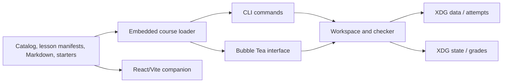

# Architecture

cli-silly has one learning engine with two interfaces. The Linux CLI owns workspaces, command execution, checks, and progress. The companion site renders published explanations, examples, and rubrics from the same bundled course.

## Current boundaries

| Area | Source | Responsibility |
| --- | --- | --- |
| Course | `course/assets.go`, `course/catalog.json`, `course/workshops/` | Embed and load lessons. Validate identity, revisions, allowed check types, paths, and the point total. |
| Command line | `cmd/cli-silly/` | Resolve lesson context, provide text and JSON output, and dispatch the selected action. |
| Terminal | `internal/tui/` | Handle navigation, search, panels, resize, hints, and Bash handoff. Read grading results from the lab layer. |
| Lab engine | `internal/lab/` | Prepare, inspect, and reset workspaces. Evaluate typed criteria. Save the latest and best score. |
| Companion | `src/course/`, React route components | Load published content at build time. Provide stable lesson links, the corresponding CLI command, and the shared installation guide at `/install`. |
| Verification and distribution | `Makefile`, `scripts/`, `.github/workflows/` | Run tests, verify shell handoff, build the site, and test installation from Linux release archives. |

The runnable course has 30 core labs and thirteen optional follow-up challenges. Foundations and Core tools contain the 20 corresponding companion topics. The 34 earlier web pages are available at their existing URLs. The CLI embeds course materials with its binary. It runs without the website or a hosted account.

### Catalog groups and stable lesson identity

Catalog workshop IDs describe display groups. The prefix of a lesson ID still names its asset directory, workspace and grade namespace, and workshop URL. Catalog groups can contain existing lesson IDs with different prefixes. A promoted lesson's `referenceId` maps the existing reader URL to the shared Markdown. This lets both surfaces publish a single lesson body and keeps existing attempts and scores available.

## Companion loading

The companion builds a navigation index from lesson and reference metadata. It loads a selected lesson's manifest and Markdown in parallel with its renderer. Reference links load just the selected reference document. Mermaid loads when a diagram is shown. The homepage uses system fonts and the small terminal-prompt brand instead of loading font packages or lesson content.

## Data and compatibility

- The current catalog's `schemaVersion` is 1. Workshop slugs group lesson IDs such as `git/selective-staging`. Keep IDs stable across ordinary content edits. Course assets include a manifest, Markdown, demo frames, and starter files.
- `starterRevision` identifies the initial file layout. Existing attempts keep the files the learner has worked on. Use reset to archive an attempt and create a fresh one.
- `gradingRevision` scopes score records. Prose-only edits preserve grading. A changed rubric must explicitly define which past scores count and how the UI presents them.
- `check --json` returns structured criterion results, a score, and completion. Exit codes are 0 for complete, 1 for incomplete, and 2 for a command or checker error. Persist completed grading runs through the lab store.
- Workspaces live in `$XDG_DATA_HOME/cli-silly/workspaces/<lesson-id>`. The workspace marker identifies the lesson, starter revision, and Compose project where relevant. Grade records live in `$XDG_STATE_HOME/cli-silly/progress/<lesson-id>/<grading-revision>.json`. Default directories and isolated development paths are in [local development](development.md).

- `reading.json` lives alongside the grade directories under the CLI state root. It stores a version, a last-read position, and a list of bookmarks. Each position contains the stable lesson ID and a heading-derived anchor. No grade record is involved in saving a reading position. `review.json` stores question outcomes by lesson and question ID. Practice records carry the most recent passing date for each linked variant. New follow-up records use one-, three-, seven-, fourteen-, and thirty-day review intervals. Only a due passing attempt advances the interval; early checks do not push the due date forward. Failures shorten a future review to at most one day. Existing records retain the one-day fallback until an attempt establishes the new schedule.

A per-lesson lock serializes workspace mutations and score writes. Workspace creation prepares a temporary directory before publishing it. Reset archives the old attempt and attempts to restore it if preparation fails. The checker verifies the workspace selected by shell context before recording a score. A file-only check on Bash return also matches the workspace identity captured before handoff and saves only changed results. Git, runtime, and script checks require an explicit action.

A separate lock protects reading state. The CLI combines the shared `lesson.md` with optional `terminal.md` notes. The companion continues to use `lesson.md`. Goldmark identifies stable section anchors and Glamour formats the scrollable chapter for the current terminal width. Resume and bookmarks use the same anchors.

An optional demo `flow` lists the stages of a worked example. The terminal animates those stages independently of shell execution. The companion renders the labels as a static path. Checking and scoring remain in the lab engine. The terminal animates the display from measured results and stops the animation when the learner leaves the view.

## Execution

Checks inspect files, local Git state, archives, script behavior, loopback HTTP, or scoped Compose resources. The CLI uses bounded reads and timeouts for external checks. A lab that grades a learner script states that behavior and tests it with separate fixtures. The Bash handoff gives the learner the permissions of their current user. A checkout-local workspace organizes practice files and progress.

Use the package-specific readiness checks before starting experiments. Git and SSH lessons can be completed locally. Service diagnostics read journal and unit fixtures. Docker uses unique Compose projects and loopback ports. Runtime operations and cleanup belong within the selected lab.

## Installed course packages

The course library loads the embedded catalog and local, declarative packs. A versioned manifest declares the pack namespace and the lessons it contains. The loader validates an isolated staging directory before atomically switching the active version. Higher versions preserve compatible workspaces and grades. Reading state holds the selected course for startup and continue.

The first pack format allows authored Markdown, starter assets, optional knowledge checks, and allowlisted file-based criteria. Installation accepts a directory or bounded tar.gz archive. It rejects symlinks, escaping paths, incompatible manifests, and checker kinds that run code or invoke other tools. The [course pack guide](course-packs.md) documents how to install and author the example.

## Characterization

Preserve the installation route, direct lesson URLs, the `/intro` redirect, and Markdown code rendering during companion migration. Capture these behaviors in browser tests before changing routes. Use a pseudo-terminal to verify keyboard input, resize, Bash suspension, and return. Use actual starter, partial, and complete submissions to characterize grading. Follow the [roadmap](../plan.md) for the next gaps and release criteria.

## Product completion decisions

### Additive grading guards and historical results

Built-in criteria may declare `preserve`, a list of starter files whose bytes must stay unchanged. Failure earns zero for that criterion and names the input to inspect. This catches otherwise-correct reports made after damaging required inputs. Such rubric changes increment `gradingRevision`; older grade files remain untouched. `previousBest` records the best earlier rubric result separately from the current best. The intro and archive follow-up now use revision 2. Version 1 third-party course packs cannot use this extension; they should express preservation as ordinary text criteria.

### Recovery and portability

`inspect` reads a bounded file tree and, for Git labs, local status/history through the existing controlled Git invocation. It never runs starter code. Archive restore swaps attempts under the lesson lock and preserves both workspaces. Backups store directories and regular files under versioned `data/` and `state/` archive namespaces, skip locks and incomplete temporary writes, reject links and special files, and enforce size/entry-count limits. Import stages and validates first, then publishes only into empty destinations. Backups are local files; no service receives them. Close active sessions before export/import for a consistent snapshot.

### Projects and presentation

`course/projects.json` declares five ordered application workflows using existing stable lesson IDs. Projects compose separately graded labs. The terminal opens the first unfinished project step. The companion reads the same project definitions. The welcome screen and Ctrl+k action menu are navigation helpers; Read and Do remain the primary learning modes. Inspection runs outside the event handler so keyboard cancellation remains available.
