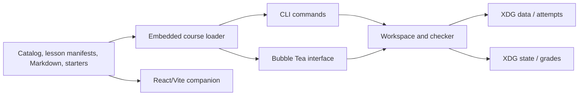

# Architecture

cli-silly has one learning engine with two interfaces. The Linux CLI owns workspaces, command execution, checks, and progress. The companion site renders published explanations, examples, and rubrics from the same bundled course.

## Current boundaries

| Area | Source | Responsibility |
| --- | --- | --- |
| Course | `course/assets.go`, `course/catalog.json`, `course/workshops/` | Embed and load lessons. Validate identity, revisions, allowed check types, paths, and the point total. |
| Command line | `cmd/cli-silly/` | Resolve lesson context, provide text and JSON output, and dispatch the selected action. |
| Terminal | `internal/tui/` | Handle navigation, search, panels, resize, hints, and Bash handoff. Read grading results from the lab layer. |
| Lab engine | `internal/lab/` | Prepare, inspect, and reset workspaces. Evaluate typed criteria. Save the latest and best score. |
| Companion | `src/course/`, React route components | Load published content at build time. Provide stable lesson links, the corresponding CLI command, and the shared installation guide at `/install`. |
| Verification and distribution | `Makefile`, `scripts/`, `.github/workflows/` | Run tests, verify shell handoff, build the site, and test installation from Linux release archives. |

The runnable course has 20 core labs in eight workshops plus an optional review challenge. The 34 earlier web pages are available as references at their existing URLs. The CLI embeds course materials with its binary. It runs without the website or a hosted account.

## Data and compatibility

- The current catalog's `schemaVersion` is 1. Workshop slugs group lesson IDs such as `git/selective-staging`. Keep IDs stable across ordinary content edits. Course assets include a manifest, Markdown, demo frames, and starter files.
- `starterRevision` identifies the initial file layout. Existing attempts keep the files the learner has worked on. Use reset to archive an attempt and create a fresh one.
- `gradingRevision` scopes score records. Prose-only edits preserve grading. A changed rubric must explicitly define which past scores count and how the UI presents them.
- `check --json` returns structured criterion results, a score, and completion. Exit codes are 0 for complete, 1 for incomplete, and 2 for a command or checker error. Persist completed grading runs through the lab store.
- Workspaces live in `$XDG_DATA_HOME/cli-silly/workspaces/<lesson-id>`. The workspace marker identifies the lesson, starter revision, and Compose project where relevant. Grade records live in `$XDG_STATE_HOME/cli-silly/progress/<lesson-id>/<grading-revision>.json`. Default directories and isolated development paths are in [local development](development.md).

- `reading.json` lives alongside the grade directories under the CLI state root. It stores a version, a last-read position, and a list of bookmarks. Each position contains the stable lesson ID and a heading-derived anchor. No grade record is involved in saving a reading position. `review.json` stores question outcomes by lesson and question ID. Practice records carry the most recent passing date for each linked variant. The review queue uses a one-day interval after a passing attempt.

A per-lesson lock serializes workspace mutations and score writes. Workspace creation prepares a temporary directory before publishing it. Reset archives the old attempt and attempts to restore it if preparation fails. The checker verifies the workspace selected by shell context before recording a score. Preserve these semantics when introducing additional course namespaces. A separate lock protects reading state updates. The reader uses Goldmark to identify sections and Glamour to format them. It reflows content for the current width and opens the overview when an anchor is missing.

## Execution

Checks inspect files, local Git state, archives, script behavior, loopback HTTP, or scoped Compose resources. The CLI uses bounded reads and timeouts for external checks. A lab that grades a learner script states that behavior and tests it with separate fixtures. The Bash handoff gives the learner the permissions of their current user. A checkout-local workspace organizes practice files and progress.

Use the package-specific readiness checks before starting experiments. Git and SSH lessons can be completed locally. Service diagnostics read journal and unit fixtures. Docker uses unique Compose projects and loopback ports. Runtime operations and cleanup belong within the selected lab.

## Planned course packages

Introduce a versioned package source once a second course can exercise it. Keep built-in, trusted course behavior available through the current entry points. Give installed packages stable course namespaces and preserve unqualified IDs for existing built-in lessons. The first package format will use declarative content and allowlisted check types. The [roadmap](../plan.md) specifies the compatibility and verification work required before packages are installable.

## Characterization

Preserve the installation route, direct lesson URLs, the `/intro` redirect, and Markdown code rendering during companion migration. Capture these behaviors in browser tests before changing routes. Use a pseudo-terminal to verify keyboard input, resize, Bash suspension, and return. Use actual starter, partial, and complete submissions to characterize grading. Follow the [roadmap](../plan.md) for the next gaps and release criteria.
